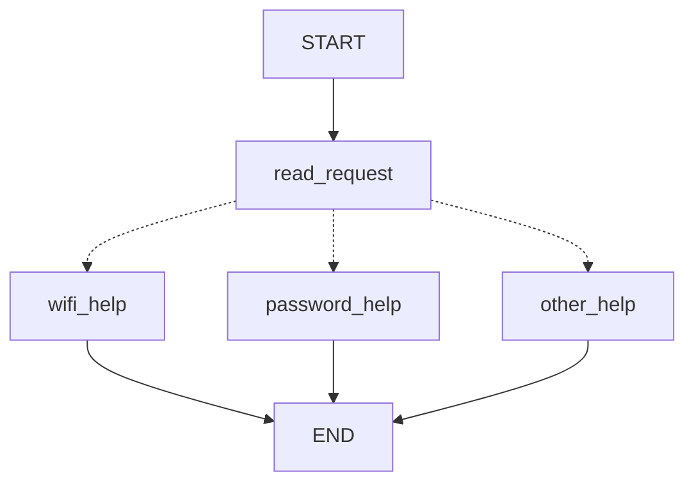
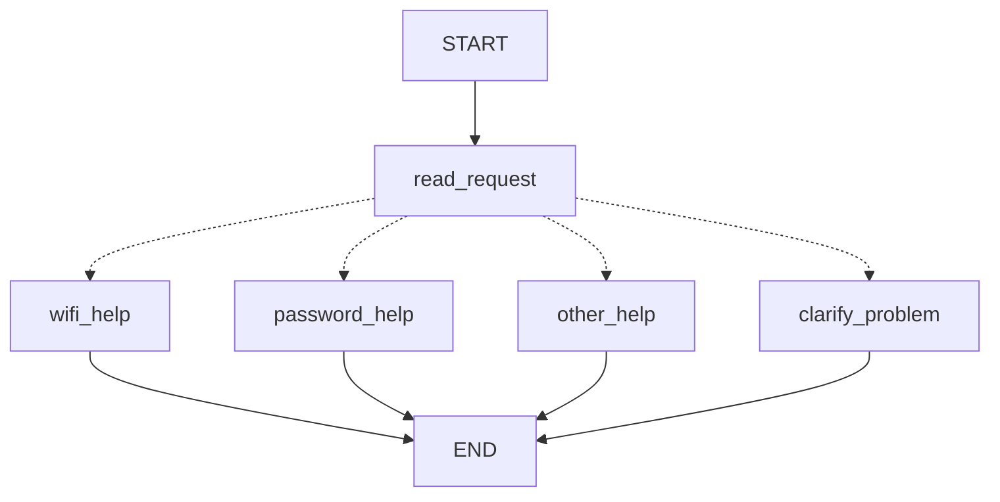
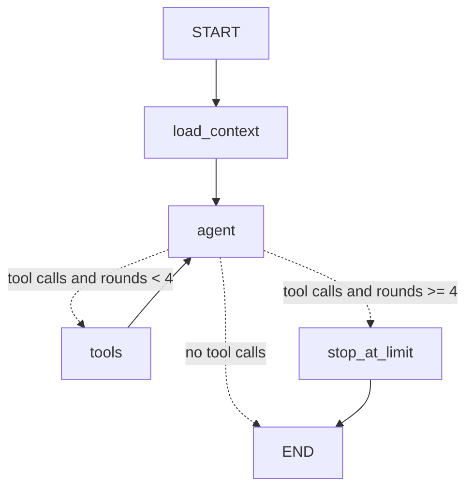

# HW5 - My LangGraph helpdesk

**Where the evidence is.** Part 1 uses no model. Parts 2 and 3 were run with a real model: provider **OpenAI** (through `langchain-openai`), model **`gpt-6-luna`**. Those logs are in `outputs/real-model-logs/` and are the main demonstration. The tests and CI use a clearly labelled offline **FAKE rule-based model** (`helpdesk/fake_model.py`, not an LLM). Runs with it are kept in `outputs/fake-model-logs/` only for comparison.

Items marked `<<FILL IN>>` need your own value before you submit (list at the end).

## Part 1 - How the graph works

### My graph and state

State (`HelpdeskState` in `helpdesk/part1.py`): `message` (original text, never changed), `category` (`wifi`, `password`, `other`), `reply`.

Generated from the compiled graph: `outputs/diagrams/part1-original.mmd`. Dotted lines are the conditional edge.

| Node | Reads | Changes |
| --- | --- | --- |
| `read_request` | `message` | sets `category` |
| `wifi_help` | nothing from the state (uses `helpdesk.json`) | sets `reply` to the Wi-Fi guide |
| `password_help` | nothing from the state (uses `helpdesk.json`) | sets `reply` to the password guide |
| `other_help` | nothing | sets `reply` to the question "Wi-Fi or password?" |

1. **What each node reads and changes:** see the table.
2. **Update versus conditional edge:** a node returns a partial update that LangGraph merges into the state (it says *what changed*). A conditional edge is a function (`choose_next_node(state)`) that returns the *name of the next node*. It changes nothing in the state (it says *where to go*).
3. **What the next node receives:** the current merged graph state, not only the previous node's update. `wifi_help` could still read `message` although only `read_request` ran before it. In the traces `state_after` always still contains `message`.
4. **START, END, compile:** `START` and `END` are special entry and exit points, not functions that I wrote. `compile()` checks the graph (nodes exist, edges lead somewhere) and turns the description into a runnable object with `invoke` and `stream`.

### Predictions before running

| Message | Predicted route | Actual route | What I learned |
| --- | --- | --- | --- |
| I cannot connect to Wi-Fi. | read_request -> wifi_help | read_request -> wifi_help | "Wi-Fi" matches the alias `wi-fi` |
| I forgot my PASSWORD. | read_request -> password_help | read_request -> password_help | lowercasing makes `PASSWORD` match |
| My laptop screen is broken. | read_request -> other_help | read_request -> other_help | no keyword, so the fallback rule applies |
| My Wi-Fi password does not work. | read_request -> wifi_help | read_request -> wifi_help | rule 1 (Wi-Fi) wins, the password part is ignored |

Traces with the state after each node: `outputs/part1/original-1.json` to `original-4.json`, and the scenario logs S01-S04.

When a message mentions both Wi-Fi and a password, rule 1 is checked first, so the router returns `wifi_help` and rule 2 is never evaluated. A user asking about a Wi-Fi password gets only Wi-Fi steps. This is a flaw of the original rules, not of LangGraph.

### My change to the graph

`read_request` now sets `category = "both"` when both topics appear. The router sends it to a new node `clarify_problem`, which asks which problem the user wants to solve first.

New trace for "My Wi-Fi password does not work." (scenario S05, `outputs/real-model-logs/S05.json`): `START -> read_request -> clarify_problem -> END`, with `category = "both"` and the reply "Is the problem connecting to Wi-Fi, or recovering your account password? Tell me which one you want to solve first." The three single-topic messages still take their old routes (`tests/test_routing.py`). The change is in the graph (a new node and a new route), not only in a sentence of an existing node.

**What LangGraph controls:** running nodes in the order given by the edges, merging each returned update into the state, calling the conditional function and following the node name it returns, stopping at `END`, and producing the trace. **What my Python functions decide:** how a message is classified (`classify_original`, `classify_with_clarification`), the routing table in `choose_next_node`, and the wording of every reply. There is no model in Part 1.

## Part 2 - Model and tools

Tools (`helpdesk/tools.py`): `find_instructions`, `check_service_status`, `prepare_ticket`, plus a fourth tool `save_user_preference` that writes user memory in Part 3. The first three work without the agent: `python -m helpdesk tool ...`, results saved in `outputs/direct-tools/` (including the outage and unknown-status snapshots and a refused ticket with missing details).

Generated from the compiled graph: `outputs/diagrams/part2-agent-loop.mmd`.

**Loop limit.** The `tools` node adds 1 to `tool_rounds` each time it runs. The conditional edge `route_after_agent` sends the flow to `stop_at_limit` instead of `tools` when `tool_rounds >= MAX_TOOL_ROUNDS` (4). `stop_at_limit` answers every unanswered tool call with an error message (so the saved history stays valid for a real model), adds a final message and sets `limit_reached = True`. The counter is reset at the start of every user message. LangGraph's own `recursion_limit` (30) is only a second safety net. Demonstration with a model that never stops asking for tools: `outputs/fake-model-logs/loop-limit.json` (4 tool rounds, then `stop_at_limit`). In all real-model runs `limit_reached` was `false`.

1. **How the graph decides between a tool and an answer:** after every `agent` run, `route_after_agent` looks at the last message. If it has `tool_calls` the flow goes to `tools` (or to `stop_at_limit`); if not, to `END`.
2. **Who requests a tool and who executes it:** the model only *requests* a tool by putting a name and arguments into its message. My `tools` node *executes* it (`execute_tool`). The tool schemas shown to the model have no working function behind them.
3. **What changes in the state after a tool result:** `messages` gets one `ToolMessage` per call, `tool_rounds` goes up by 1, `status_checks` stores the result of a status check, `sources` gets a line naming the reference file. Then the agent runs again with the longer message list.
4. **Difference from Part 1:** in Part 1 my function chooses the route from keywords before anything runs. Here the path is not known in advance: the model decides which tools to request and whether to continue, and its next step depends on tool results (operating, outage, unknown). The graph structure (a loop with a limit) is fixed, the number and order of steps is not.

The model never decides facts about the system. The ticket's `service_status` is taken from `status_checks`, which is filled from the real tool result, not from arguments written by the model. `user_id`, the conversation id and the status snapshot come from the application's configuration, not from the model.

### Real model run (OpenAI, `gpt-6-luna`)

Command: `python -m helpdesk scenario S06 --model openai --out outputs/real-model-logs` (and the same for S07 and S08; `scenario all` for everything). The `model` field of each log says `OpenAI via langchain-openai, model gpt-6-luna`. The model rejected `temperature=0` (HTTP 400, "not supported with this model"), so I removed that parameter in `helpdesk/app.py`.

S06, second message, snapshot `normal` (`outputs/real-model-logs/S06.json`):

1. `load_context`: sources show 4 earlier messages from the checkpoint and empty user memory.
2. `agent` requests `check_service_status {service: wifi}`.
3. `tools` returns `status: operational`; state: `tool_rounds = 1`, `status_checks.wifi.status = operational`.
4. `agent` requests `prepare_ticket {category: wifi, summary: "Campus-Demo will not connect.", steps_tried: [Enabled Wi-Fi., Forgot the saved network., Tried connecting to Campus-Demo.]}`.
5. `tools` returns `created: true`, file `outputs/real-model-logs/tickets/TCK-66B3424F.json` (its `service_status` is `operational`, taken from the status check).
6. `agent` answers that Wi-Fi is operational, that a local draft `TCK-66B3424F` was prepared and that nothing was sent.

The same conditional request with different snapshots (real model):

| Snapshot | Scenario | Tools requested by the model | Result |
| --- | --- | --- | --- |
| `normal` (operational) | S06 | check_service_status, then prepare_ticket | ticket draft created |
| `wifi_outage` | S07 | check_service_status and find_instructions (same round) | no ticket; says Wi-Fi is down across campus and that no repair time is given |
| `status_unavailable` (unknown) | S08 | check_service_status and find_instructions (same round) | no ticket; says it cannot confirm Wi-Fi is operating, asks whether to prepare a draft anyway |

So the behaviour depended on the tool result, as required.

**Differences between the real model and my fake model.** The real model chose its own extra calls: in S07 and S08 it also called `find_instructions`, which was not needed for the answer, and in S10 and S11 it called `check_service_status` although the user had not asked for it. It asked follow-up questions of its own (in S08: whether airplane mode was checked). In S06 it listed a third step, "Tried connecting to Campus-Demo.", in the ticket. The user only said they enabled Wi-Fi, forgot the network, and that Campus-Demo still would not connect, so this step is the model's own paraphrase of the failure and is slightly more than the user stated. The fake model was stricter. See the limitations.

## Part 3 - Memory

- **Conversation memory** is the graph state (messages, tool results, `status_checks`) saved by a LangGraph `SqliteSaver` checkpointer into `local-storage/checkpoints.sqlite` after every step.
- **User memory** is a separate SQLite table (`local-storage/user_memory.sqlite`, table `preferences`, primary key `(user_id, key)`). It is written only by the `save_user_preference` tool after the user asks to remember something, and read by `load_context` at the start of every turn using the `user_id` that my application passes in. The model cannot choose which user's data is loaded. It is not read from `demo_users.json`.
- **`thread_id` versus user id:** `thread_id` identifies one conversation, meaning one message history that the checkpointer can resume. The user id identifies a person, meaning data that should outlive any single conversation. One user can have many threads. My checkpoint key is `"<user_id>/<thread_id>"`, so two users who type the same thread name still get separate conversations (`test_same_thread_name_for_two_users_is_two_conversations`).
- **Why instructions are retrieval and language is memory:** instructions are looked up in a shared reference file (`helpdesk.json`) that is the same for everybody and exists before any conversation. The language preference is something this particular user told the assistant earlier, saved by the application and returned only for that user.

| Situation | Command used | Log file | What happened (real model) |
| --- | --- | --- | --- |
| Refer to an earlier message | `python -m helpdesk scenario S10 --model openai` | `outputs/real-model-logs/S10.json` | "Which steps did I already try?" was answered from the first message: enabled Wi-Fi, forgot the saved network, tried reconnecting. Sources: `conversation_state: 5 earlier messages`. |
| Close, restart and resume | S11 (same command) | `outputs/real-model-logs/S11.json` | The first message ran in process 1876, the second in a new process 13192. The reply recalled the Wi-Fi problem and the steps. Sources: `conversation_state: 7 earlier messages` and `user_memory[demo-user-a]: {'language': 'Kazakh'}`. |
| Same user, new conversation | S12 | `outputs/real-model-logs/S12.json` | New process and new thread `preference-a2`: the model replied in Kazakh and said the user had asked for Kazakh. Sources: only `user_memory[demo-user-a]` and no `conversation_state`. |
| Different user | S13 | `outputs/real-model-logs/S13.json` | demo-user-b: sources only `user_memory[demo-user-b]: empty`. The reply said no preferred language or previous problem was mentioned. |

I did not hard-code the language: the model called `save_user_preference {language: Kazakh}` itself in S11, S12 and S13 (visible in the logs), and the stored value was read back in a new process. The "Sources" lines show for each turn whether data came from the checkpoint (conversation memory), from user memory, or from the reference files.

## Part 4 - Running and checking my work

README: `README.md` (install, `.env`, run commands, scenarios, where memory is stored and how to clear it with `python -m helpdesk reset`). Dependencies are pinned in `requirements.txt`. Python version: `3.13.15` (I also developed on 3.12.3 and CI uses 3.12). CI: `.github/workflows/tests.yml` runs `python -m pytest -q` on every push without any API key. All tests use the fake model; the real-model demonstration is run by hand and is never run by CI. CI result: `https://github.com/amanzhol10/css4007-hw5/actions/runs/42689245810`.

| Test file | What it would catch |
| --- | --- |
| `test_routing.py` | rule order changed (for example password checked before Wi-Fi), case sensitivity, a missing `other_help` fallback, `clarify_problem` not reached or other routes broken by the change, state not recorded in the trace |
| `test_tools.py` | wrong instruction lookup, a status snapshot read wrongly (especially unknown treated as operating), tickets missing template fields, a ticket created with missing details or with a secret, a file written when it should not be |
| `test_agent.py` | operating, outage and unknown no longer leading to different actions, the ticket status taken from the wrong place, missing details not leading to a question, no loop limit, dangling tool calls after the limit, counter not reset on the next turn |
| `test_memory.py` | conversation or preference lost after closing, memory that works only inside one process (a test starts real separate processes), history not read from the checkpoint |
| `test_isolation.py` | one user seeing another's preference, the same thread name mixing two users, two threads of one user sharing history, a preference not available in a new thread of the same user |

I checked that the tests can fail: when I broke the code on purpose (removed the user prefix from the checkpoint key, moved the password rule before the Wi-Fi rule, removed the loop limit) the matching tests failed (1 failure, 1 failure, and a recursion error).

## Choices and limitations

- **Storage:** SQLite for both memories, because it is a single local file, needs no server, survives restarts, and the checkpointer package was supplied. Two separate files keep the two kinds of memory visibly separate. Plain `sqlite3` is enough for one preference key per user.
- **Libraries:** LangGraph for the graphs and the checkpointer, `langchain-openai` as the supplied adapter, pydantic schemas for tool arguments.
- **A fourth tool** (`save_user_preference`) was added because a preference must be learned from a message. The assignment lists three tools for the helpdesk itself.
- **The model invented a ticket step (S06).** The ticket draft `TCK-66B3424F` lists "Tried connecting to Campus-Demo." which the user did not say as a separate step. The system prompt says never to invent steps, but a model can still paraphrase. A stricter fix would be to ask the model to quote the user's steps only, or to validate steps against the user's text.
- **Extra and unrequested tool calls.** In S07, S08, S10 and S11 the real model called tools the user did not ask for (`find_instructions`, `check_service_status`). They are harmless here (no ticket was created wrongly) but cost extra requests. I did not change the prompt after seeing them.
- **Replies in the ticket flow are short.** In S09 the reply names the ticket id but not the file path or the steps. The path is in the log (`tickets` field).
- **Stale status.** A status check is stored in the conversation, so a later ticket in the same conversation can use an old status.
- **Secrets check is simple.** The ticket tool refuses text that matches a pattern like "password is ...". It is not a full secret scanner.
- **Not tested:** only one real model (`gpt-6-luna`) was run once per scenario, so I do not know how stable its tool choices are across repeated runs. A leftover ticket `outputs/real-model-logs/tickets/TCK-A0A4F2AD.json` comes from my first trial run of S06 and is not referenced by the final S06 log.
- **S01-S05** were started with `--model openai` in the command, but they use no model (the log says "no model (Part 1)").

## Supplied scenarios - my actual results

Command pattern: `python -m helpdesk scenario <ID> --model openai --out outputs/real-model-logs` (all at once: `python -m helpdesk scenario all --model openai`). Model for S06-S14: `gpt-6-luna` (OpenAI). S01-S05 use no model. Fake-model runs of the same scenarios are in `outputs/fake-model-logs/` and were used for tests and comparison only.

| Scenario | Command or manual steps | Log file | What happened / what I changed |
| --- | --- | --- | --- |
| S01 - Simple Wi-Fi route | `scenario S01` | `outputs/real-model-logs/S01.json` | read_request -> wifi_help; Wi-Fi guide returned |
| S02 - Case-insensitive password route | `scenario S02` | `outputs/real-model-logs/S02.json` | read_request -> password_help despite capital letters |
| S03 - Unsupported request | `scenario S03` | `outputs/real-model-logs/S03.json` | read_request -> other_help; asks Wi-Fi or password |
| S04 - Two topics before the graph change | `scenario S04` (original graph) | `outputs/real-model-logs/S04.json` | went to wifi_help; the password part was ignored (rule 1 first) |
| S05 - Two topics after adding clarification | `scenario S05` (changed graph) | `outputs/real-model-logs/S05.json` | went to clarify_problem and asked which problem to solve first |
| S06 - Instructions then local ticket | `scenario S06` | `outputs/real-model-logs/S06.json` | find_instructions; then check_service_status (operational) and prepare_ticket; draft `TCK-66B3424F`; the draft has one extra step the user did not state |
| S07 - The same request during a Wi-Fi outage | `scenario S07` | `outputs/real-model-logs/S07.json` | status outage; no ticket; said no repair time is given; also called find_instructions needlessly |
| S08 - Status source unavailable | `scenario S08` | `outputs/real-model-logs/S08.json` | status unknown; no ticket; said it cannot confirm Wi-Fi is operating and asked whether to draft one anyway |
| S09 - Missing ticket details | `scenario S09` | `outputs/real-model-logs/S09.json` | first message: question, no ticket; second: draft `TCK-A0D8A1DC` with the steps given, status `not_checked` |
| S10 - Use the current conversation | `scenario S10` | `outputs/real-model-logs/S10.json` | steps recalled correctly from conversation state |
| S11 - Persist and recall after restart | `scenario S11` | `outputs/real-model-logs/S11.json` | preference saved by the model; real new process between the messages; problem and steps recalled, in Kazakh |
| S12 - Preference across threads without replay | `scenario S12` | `outputs/real-model-logs/S12.json` | new process and new thread; Kazakh recalled from user memory, answer in Kazakh |
| S13 - Do not share memory between users | `scenario S13` | `outputs/real-model-logs/S13.json` | demo-user-b got nothing from demo-user-a |
| S14 - Password recovery outage | `scenario S14` | `outputs/real-model-logs/S14.json` | looked up `account_recovery` (not Wi-Fi); reported a known problem and no repair time |

If a run behaved wrongly, the places I would change first are the system prompt in `helpdesk/agent.py` (for example "quote only steps the user stated", "do not call tools the user did not ask for") and the tool descriptions in `helpdesk/tools.py`.

## Before submitting: fill in

1. The Python version line in Part 4.
2. The link to the green GitHub Actions run in Part 4.
