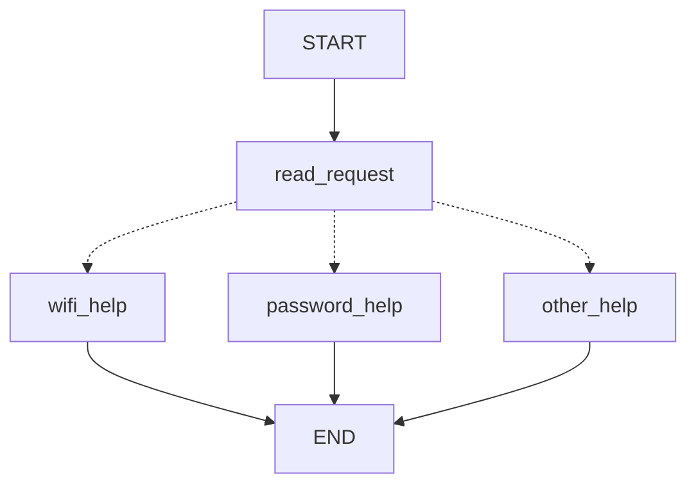
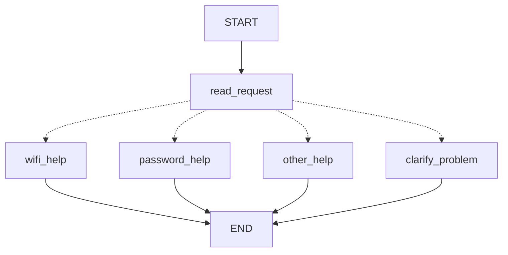
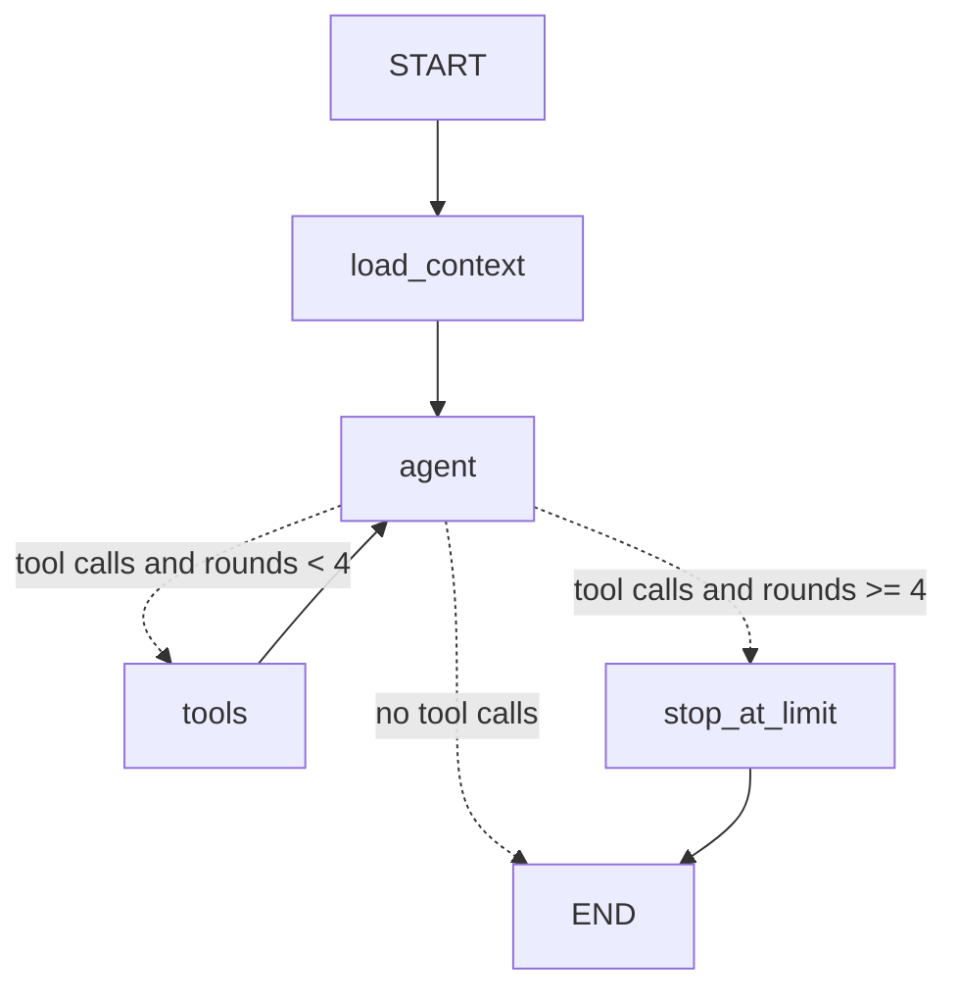

# HW5 - My LangGraph helpdesk

> **Read this first.** Every agent run saved in `outputs/fake-model-logs/` used the offline **FAKE rule-based model** (`helpdesk/fake_model.py`). It is not an LLM and it is not the model demonstration. Part 1 uses no model at all. The real-model run of Part 2 is described in the section "Real model run" and must be produced with `python -m helpdesk scenario all --model openai`; its logs go to `outputs/real-model-logs/`.

## Part 1 - How the graph works

### My graph and state

State (`HelpdeskState` in `helpdesk/part1.py`): `message` (original text, never changed), `category` (`wifi`, `password`, `other`), `reply`.



Generated from the compiled graph: `outputs/diagrams/part1-original.mmd`. Dotted lines are the conditional edge.

| Node | Reads | Changes |
| --- | --- | --- |
| `read_request` | `message` | sets `category` |
| `wifi_help` | nothing (uses `helpdesk.json`) | sets `reply` to the Wi-Fi guide |
| `password_help` | nothing (uses `helpdesk.json`) | sets `reply` to the password guide |
| `other_help` | nothing | sets `reply` to the question "Wi-Fi or password?" |

1. **Reads and changes:** see the table.
2. **Update versus conditional edge:** a node returns a partial update that LangGraph merges into the state (it says *what changed*). A conditional edge is a function `choose_next_node(state)` that returns the *name of the next node*; it changes nothing in the state (it says *where to go*).
3. **What the next node receives:** the current merged graph state, not only the previous node's update. `wifi_help` could still read `message` although only `read_request` ran before it. My trace shows this: `state_after` always still contains `message`.
4. **START, END, compile:** `START` and `END` are special entry and exit points, not functions. `compile()` checks the graph (nodes exist, edges lead somewhere) and turns the description into a runnable object with `invoke`/`stream`.

### Predictions before running

| Message | Predicted route | Actual route | What I learned |
| --- | --- | --- | --- |
| I cannot connect to Wi-Fi. | read_request -> wifi_help | read_request -> wifi_help | "Wi-Fi" matches the alias `wi-fi` |
| I forgot my PASSWORD. | read_request -> password_help | read_request -> password_help | lowercasing makes `PASSWORD` match |
| My laptop screen is broken. | read_request -> other_help | read_request -> other_help | no keyword, so the fallback rule |
| My Wi-Fi password does not work. | read_request -> wifi_help | read_request -> wifi_help | rule 1 (Wi-Fi) wins and the password part is ignored |

Traces with the state after each node: `outputs/part1/original-1.json` to `original-4.json`. (I wrote down the predictions from the rules before running the code. These predictions are the rules applied by hand, so they match.)

Both topics in one message: rule 1 is checked first and the router returns `wifi_help`. Rule 2 is never evaluated. The user asking about a Wi-Fi password gets only Wi-Fi steps. This is a flaw of the original rules, not a bug in LangGraph.

### My change to the graph

`read_request` now sets `category = "both"` when both topics appear. The router sends it to a new node `clarify_problem`, which asks which problem the user wants to solve first.



New trace for "My Wi-Fi password does not work." (`outputs/part1/clarification-4.json`, scenario S05): `START -> read_request -> clarify_problem -> END`, with `category = "both"` and a reply asking "Is the problem connecting to Wi-Fi, or recovering your account password?". The other three messages still take their old routes (tests in `tests/test_routing.py`).

**What LangGraph controls:** running nodes in the order given by the edges, merging each returned update into the state, calling the conditional function and following the node name it returns, stopping at `END`, and producing the trace. **What my Python functions decide:** how a message is classified (`classify_original`, `classify_with_clarification`), the routing table in `choose_next_node`, and the wording of every reply. There is no model in Part 1.

## Part 2 - Model and tools

Tools (`helpdesk/tools.py`): `find_instructions`, `check_service_status`, `prepare_ticket`, plus a fourth tool `save_user_preference` that writes user memory in Part 3. Each of the first three works without the agent: `python -m helpdesk tool ...`, saved in `outputs/direct-tools/`.



Generated from the compiled graph: `outputs/diagrams/part2-agent-loop.mmd`.

**Loop limit.** The tools node adds 1 to `tool_rounds` each time it runs. The conditional edge `route_after_agent` sends the flow to `stop_at_limit` instead of `tools` when `tool_rounds >= MAX_TOOL_ROUNDS` (4). `stop_at_limit` answers every unanswered tool call with an error message (so the saved history stays valid for a real model), adds a final message and sets `limit_reached = True`. The counter is reset at the start of each user message. LangGraph's own `recursion_limit` (30) is only a second safety net. Demonstration with a model that never stops asking for tools: `outputs/fake-model-logs/loop-limit.json` (4 tool rounds, then `stop_at_limit`). A test fails with a recursion error if my limit is removed (I checked this by temporarily removing it).

1. **How the graph decides between a tool and an answer:** after every `agent` run, `route_after_agent` looks at the last message. If it has `tool_calls` it goes to `tools` (or to `stop_at_limit`); if not it goes to `END`.
2. **Who requests and who executes:** the model only *requests* a tool by putting a name and arguments into its message. My `tools` node *executes* it (`execute_tool`). The schemas given to the model have no working function behind them.
3. **State after a tool result:** `messages` gets one `ToolMessage` per call, `tool_rounds` goes up by 1, `status_checks` stores the result of a status check, `sources` gets a line naming the reference file. Then the agent runs again with the longer message list.
4. **Difference from Part 1:** in Part 1 my function chooses the route from keywords before anything runs. Here the path is not known in advance: the model decides which tool to request and whether to continue, and the next request depends on tool results (outage, operating or unknown). The graph structure (loop with a limit) is fixed; the number and order of steps is not.

**The model never decides facts about the system.** The ticket's `service_status` is taken from `status_checks` (stored from the real tool result), not from arguments typed by the model. `user_id`, the thread and the status snapshot come from the application's configuration, not from the model.

### Real model run

**TODO (needs your API key):** run

```powershell
python -m helpdesk scenario S06 --model openai
python -m helpdesk scenario S07 --model openai
python -m helpdesk scenario S08 --model openai
```

then write here the model name and provider that appear in the `model` field of `outputs/real-model-logs/S06.json`, and a short comparison with the fake-model run below. I have not run a real model, so I do not claim any real-model behaviour here.

### Actual run with the FAKE model (same graph, same tools)

S06 second message, snapshot `normal` (`outputs/fake-model-logs/S06.json`):

1. `load_context` - sources: 4 earlier messages from the checkpoint, user memory empty.
2. `agent` requests `check_service_status {service: wifi}`.
3. `tools` returns `{status: operational}`; state: `tool_rounds = 1`, `status_checks.wifi.status = operational`.
4. `agent` requests `prepare_ticket {category: wifi, steps_tried: [Enabled Wi-Fi, Forgot the saved network]}`.
5. `tools` returns `created: true`, file `outputs/fake-model-logs/tickets/TCK-11B54555.json`.
6. `agent` answers that a local draft was prepared and nothing was sent.

The same conditional request with different snapshots:

| Snapshot | Scenario | Tools requested | Result |
| --- | --- | --- | --- |
| `normal` (operational) | S06 | check_service_status, prepare_ticket | ticket draft created |
| `wifi_outage` | S07 | check_service_status | no ticket; reply says outage and no repair time |
| `status_unavailable` (unknown) | S08 | check_service_status | no ticket; reply says status cannot be confirmed and asks whether to draft one |

## Part 3 - Memory

- **Conversation memory** is the graph state (messages, tool results, `status_checks`) saved by a LangGraph `SqliteSaver` checkpointer into `local-storage/checkpoints.sqlite` after every step.
- **User memory** is a separate SQLite table (`local-storage/user_memory.sqlite`, table `preferences`, primary key `(user_id, key)`). It is written only by the `save_user_preference` tool after the user asks to remember something, and read by `load_context` at the start of every turn, using the `user_id` that my application passes in. The model cannot choose which user's data is loaded. It is not loaded from `demo_users.json`.
- **`thread_id` versus user id:** `thread_id` identifies one conversation, meaning one history of messages that the checkpointer can resume. The user id identifies a person, meaning data that should outlive any single conversation. One user has many threads. The checkpointer key is `"<user_id>/<thread_id>"`, so two users who type the same thread name still get separate conversations (`test_same_thread_name_for_two_users_is_two_conversations`).
- **Why instructions are retrieval and language is memory:** instructions are looked up in a shared reference file (`helpdesk.json`) that is the same for everybody and exists before any conversation. The language preference is something this particular user told the assistant earlier, saved by the application and returned only for that user.

| Situation | Command used | Log file | What happened |
| --- | --- | --- | --- |
| Refer to an earlier message | S10 (`python -m helpdesk scenario S10 --model fake --out outputs/fake-model-logs`) | `outputs/fake-model-logs/S10.json` | "Which steps did I already try?" was answered from the earlier message; sources: `conversation_state` |
| Close, restart and resume | S11 | `outputs/fake-model-logs/S11.json` | first message in process 892, second in a new process 898; sources: `conversation_state: 4 earlier messages`, `user_memory` |
| Same user, new conversation | S12 | `outputs/fake-model-logs/S12.json` | thread `preference-a2` (new process) knew Kazakh from user memory and had no conversation state |
| Different user | S13 | `outputs/fake-model-logs/S13.json` | demo-user-b: sources only `user_memory[demo-user-b]: empty`; reply says no preference or previous problem is recorded |

(Process ids come from the saved logs of my run and will differ when you run it.) The fake model cannot translate, so it says it will reply in Kazakh but its text stays English. Whether a real model actually answers in Kazakh must be checked in the real-model logs.

## Part 4 - Running and checking my work

README: `README.md` (install, `.env`, run commands, scenarios, memory location and reset). Dependencies pinned in `requirements.txt`; tested Python 3.12.3. CI: `.github/workflows/tests.yml` runs `python -m pytest -q` on every push without any key. All tests use the fake model. Real-model demonstration is run by hand.

| Test file | What it would catch |
| --- | --- |
| `test_routing.py` | rule order changed (e.g. password checked before Wi-Fi), case sensitivity, a missing `other_help` fallback, `clarify_problem` not reached or other routes broken by the change, state not recorded in the trace |
| `test_tools.py` | wrong instruction lookup, a status snapshot read wrongly (especially unknown treated as operating), tickets missing template fields, a ticket created with missing details or with a secret, a ticket written when it should not be |
| `test_agent.py` | operating/outage/unknown no longer leading to different actions, a ticket's status taken from the wrong place, missing details not leading to a question, no loop limit, dangling tool calls after the limit, counter not reset on the next turn |
| `test_memory.py` | conversation or preference lost after closing, memory that only works in one process (the real-subprocess test), history not read from the checkpoint |
| `test_isolation.py` | one user seeing another's preference, the same thread name mixing two users, two threads of one user sharing history, a preference not available in a new thread of the same user |

I confirmed that the tests fail when I break the code: user namespace in the thread key removed (1 failure), password rule moved before Wi-Fi (1 failure), loop limit removed (recursion error).

## Choices and limitations

- **Storage:** SQLite for both memories, because it is a single local file, needs no server, survives restarts and the checkpointer package was supplied. Two separate files keep the two kinds of memory visibly separate. Plain `sqlite3` for preferences is enough for one key per user.
- **Libraries:** LangGraph for the graphs and checkpointer, `langchain-openai` as the supplied adapter, pydantic schemas for tool arguments.
- **A fourth tool** (`save_user_preference`) was added because a preference must be learned from a message; the assignment lists three tools for the helpdesk itself.
- **Limitations:** the real model has not been run by me, so its tool choices, its steps extraction and replying in Kazakh are untested. The fake model is a regex policy and handles only the scenario wording. A status check stored in the conversation can become stale in a later turn (a ticket would then say "operational" from an earlier check). The program does not detect secrets beyond a simple pattern. Python 3.12.3 on Linux is what I tested; I have not run it on Windows.

## Supplied scenarios - my actual results

Model for S06-S14 rows: **FAKE rule-based model**. Command pattern: `python -m helpdesk scenario <ID> --model fake --out outputs/fake-model-logs` (all: `python -m helpdesk scenario all --model fake --out outputs/fake-model-logs`). S01-S05 use no model.

| Scenario | Command or manual steps | Log file | What happened / what I changed |
| --- | --- | --- | --- |
| S01 - Simple Wi-Fi route | `scenario S01` | `outputs/fake-model-logs/S01.json` | read_request -> wifi_help; Wi-Fi guide returned |
| S02 - Case-insensitive password route | `scenario S02` | `outputs/fake-model-logs/S02.json` | read_request -> password_help despite capitals |
| S03 - Unsupported request | `scenario S03` | `outputs/fake-model-logs/S03.json` | read_request -> other_help; asks Wi-Fi or password |
| S04 - Two topics before the graph change | `scenario S04` (original graph) | `outputs/fake-model-logs/S04.json` | went to wifi_help; password part ignored (rule 1 first) |
| S05 - Two topics after adding clarification | `scenario S05` (changed graph) | `outputs/fake-model-logs/S05.json` | went to clarify_problem and asked which to solve first |
| S06 - Instructions then local ticket | `scenario S06` | `outputs/fake-model-logs/S06.json` | find_instructions, then check_service_status (operational), then prepare_ticket; draft `TCK-11B54555` |
| S07 - The same request during a Wi-Fi outage | `scenario S07` | `outputs/fake-model-logs/S07.json` | only check_service_status; no ticket; no repair time invented |
| S08 - Status source unavailable | `scenario S08` | `outputs/fake-model-logs/S08.json` | status unknown; no ticket; asked whether to draft one |
| S09 - Missing ticket details | `scenario S09` | `outputs/fake-model-logs/S09.json` | first message: question, no ticket; second: draft with the steps given, status "not_checked" |
| S10 - Use the current conversation | `scenario S10` | `outputs/fake-model-logs/S10.json` | steps recalled from conversation state |
| S11 - Persist and recall after restart | `scenario S11` | `outputs/fake-model-logs/S11.json` | real new process between the two messages; problem and steps recalled |
| S12 - Preference across threads without replay | `scenario S12` | `outputs/fake-model-logs/S12.json` | new process and new thread; language recalled from user memory |
| S13 - Do not share memory between users | `scenario S13` | `outputs/fake-model-logs/S13.json` | demo-user-b got nothing from demo-user-a |
| S14 - Password recovery outage | `scenario S14` | `outputs/fake-model-logs/S14.json` | looked up account_recovery (not Wi-Fi); outage reported, no repair time |

If a real-model run behaves wrongly, the places I would change first are the system prompt in `helpdesk/agent.py` (conditional-ticket rule, "never invent steps") and the descriptions of the tools in `helpdesk/tools.py`.
